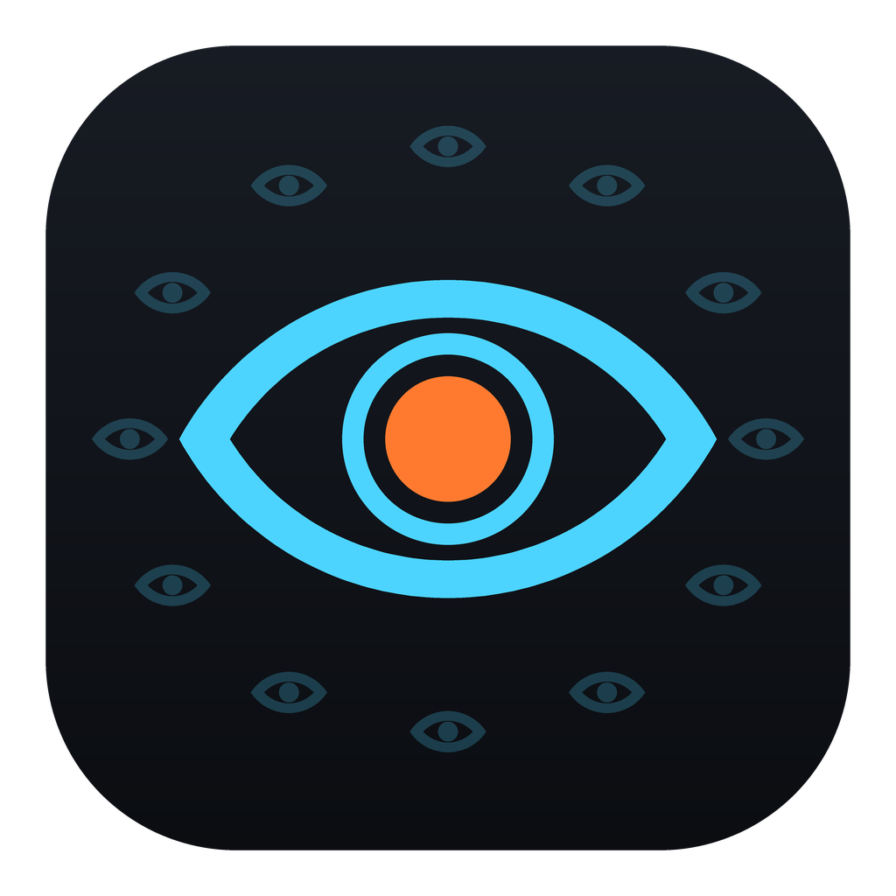
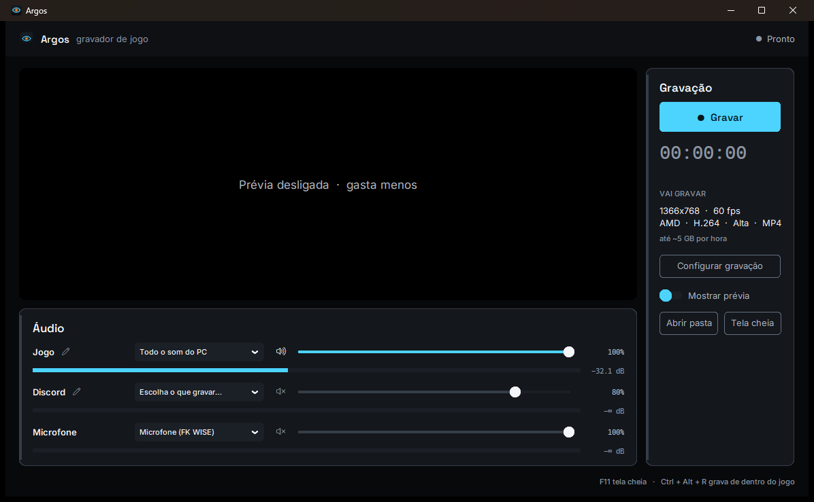

<p align="center">
  
</p>

<h1 align="center">Argos</h1>

<p align="center"><b>Gravador de jogo leve para Windows.</b><br>
Grava a tela e o som pela placa de vídeo, quase sem pesar no processador.</p>

<p align="center">
  <a href="https://github.com/PauloFSF/Argos/releases/latest/download/Argos-Windows.zip">
    
  </a>
</p>

<p align="center"></p>

## Como usar

1. Clique em **Baixar o Argos** e descompacte o `Argos-Windows.zip` numa pasta.
2. Abra o **`Argos.exe`**. Não precisa instalar nada.
3. Escolha o que gravar no **Áudio** e clique em **Gravar**.
4. Dentro do jogo, **Ctrl + Alt + R** começa e para a gravação.

> **O Windows pode avisar "O Windows protegeu o computador".** O Argos ainda não tem assinatura digital, que é paga. Clique em **Mais informações** e depois em **Executar assim mesmo**.

Os vídeos vão para `Vídeos\Argos`. Dá para trocar a pasta em **Configurar gravação**.

## O que ele faz

- **Leve:** quem comprime o vídeo é a placa de vídeo (AMD, NVIDIA ou Intel), não o processador. Medido num Ryzen 7 5700G gravando 1366x768 a 60 fps: **~5% do processador e ~180 MB de memória**.
- **Testa a sua placa sozinho** na primeira vez que abre, e só mostra as opções que funcionam no seu PC.
- **Som por programa:** a **Faixa 1** e a **Faixa 2** gravam o programa que você escolher (o jogo, o Discord, o navegador) ou o som do PC todo. Você pode renomear as duas.
- **4 trilhas de som no arquivo:** tudo misturado, mais cada faixa e o microfone separados. No DaVinci ou no Premiere, cada uma vira uma trilha que você ajusta sozinha.
- **Cor certa:** o vídeo sai no padrão de cor de vídeo (bt709), então as sombras não ficam lavadas no editor.
- **Qualidade constante** (como o OBS faz): a cena parada gasta pouco espaço, e o movimento gasta o que precisa.
- **Opções:** monitor, resolução (do monitor, 1440p, 1080p ou 720p), 30/60 fps, e 120/144/165/240 fps se o seu monitor tiver essa taxa, H.264, H.265 ou AV1, e arquivos MP4, MOV ou MKV.
- **Prévia** da tela, que você pode desligar para gastar ainda menos. Aperte **F11** para ver a prévia em tela cheia.

## Precisa de

- Windows 10 (versão 2004 ou mais nova) ou Windows 11, 64 bits.
- Para gravar o som de um programa só: Windows 10 2004 ou mais novo.

## Ainda não testado

O Argos foi testado numa placa AMD. As placas **NVIDIA** e **Intel** já estão no código, e o programa testa a placa antes de oferecer, mas ninguém gravou com elas ainda. Se der algum problema, abra uma *issue* aqui no GitHub.

## Para quem quer mexer no código

```
src/argos.pyw            a janela
src/gravar_jogo.py       o motor (captura, som, ffmpeg); também grava pelo terminal
src/som_de_programa.py   o som de um programa só (process loopback do Windows)
src/gerar_icone.py       desenha o ícone
empacotar.py             monta o Argos.exe e o .zip, e testa o pacote gravando de verdade
```

Rodar do código precisa de Python 3.12, do `ffmpeg` no PATH e de: `numpy pillow pyaudiowpatch comtypes pycaw psutil customtkinter`.

Para montar o pacote: `python empacotar.py` (precisa do [uv](https://docs.astral.sh/uv/)).

## Licenças do que vai junto

- **ffmpeg:** build "full" de [gyan.dev](https://www.gyan.dev/ffmpeg/builds/), licença GPL v3. A licença vai dentro do pacote, na pasta `licencas`.
- **Fontes Inter e Space Grotesk:** SIL Open Font License. Veja [`assets/fontes/LEIAME.md`](assets/fontes/LEIAME.md).
- **CustomTkinter:** CC0.
